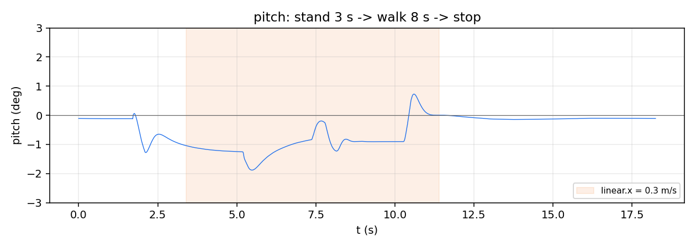
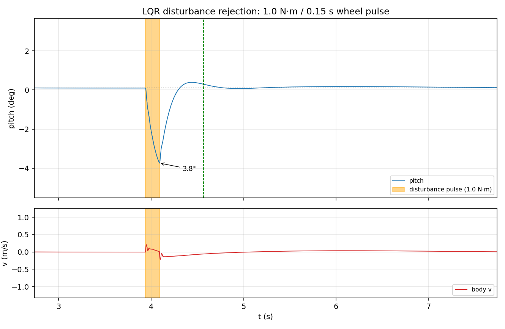

# wheel_leg_controller

ROS 2 Humble / Python 轮腿机器人控制器，对应 `02-ros2-wheelleg` 大作业第 5.7 节阶段 1→5。

## 1. 节点与话题

| 方向 | 话题 | 类型 | 说明 |
|---|---|---|---|
| 订阅 | `/joint_states` | `sensor_msgs/JointState` | 6 关节位置/速度，顺序 `right1,right2,left1,left2,rightwheel,leftwheel` |
| 订阅 | `/imu` | `sensor_msgs/Imu` | 姿态四元数 + 角速度 |
| 订阅 | `/cmd_vel` | `geometry_msgs/Twist` | `linear.x` 前后速度，`angular.z` 偏航角速度 |
| 发布 | `/actuator_cmd` | `rm_msgs/WheelLegCmd` | 6 路力矩，顺序即 `robot.xml` 的 ctrl 顺序 |

`wheel_leg_sim` 是**指令驱动**的：一条 `/actuator_cmd` = 一步仿真。节点用 `create_timer(0.002)` 驱动，周期与 `model.opt.timestep` 一致，因此 500 Hz 下 `dt` 与物理时间严格对应。

## 2. 控制结构

```
/imu ─┐
      ├─→ 四元数解算 pitch / gyro_pitch
/joint_states ─┐
      ├─→ 五连杆正运动学 (vmc_cal) ─→ L_0（腿长）、theta（腿倾角）、phi
      │                                   │
      │                    ┌──────────────┴──────────────┐
      │                    │ 内环：腿长 PID → F_0        │
      │                    │ 外环：LQR → T_p、wheel_T    │
      │                    └──────────────┬──────────────┘
      │                                   ↓
      └──────────────────→ VMC_torque_cal(F_0, T_p) → /actuator_cmd
```

- **内环 VMC**：把五连杆映射成"沿腿方向的虚拟力 F_0"，对 `L_0` 做 PID（Kp=700, Kd=5），再叠加 `4/cos(theta)` 的重力前馈。控制的是腿长而不是关节角，上层因此不必关心两个髋关节如何配合。
- **外环 LQR**：6 状态 `[theta, d_theta, x_b, v_b, phi, d_phi]`，输出轮力矩 `wheel_T` 与髋关节虚拟力矩 `T_p`，共 12 个增益。
- **速度指令**：`/cmd_vel` 经 0.8 / 1.4 m/s² 的加速/减速斜坡进入 `v_set`；`x_b_set` 只在运动时跟随轮里程计，站桩时冻结（否则位置环恒为 0，车会持续前滑）。

## 3. 参数与 K 矩阵来源

| 项 | 来源 |
|---|---|
| `vmc_cal.py` | 复制自 `Wheel_Leg/LQR_VMC/vmc_cal.py`，未修改 |
| `lqr_update.py` | 复制自 `Wheel_Leg/LQR_VMC/lqr_update.py`，未修改 |
| K 矩阵 | 由 `calc_k_matrix_from_poly(L_0)` 按当前腿长从多项式插值，每 2 ms 重算一次 |
| 腿长 PID | Kp=700, Kd=5, 输出限幅 ±150 N |
| 轮力矩限幅 | ±1.5 N·m（模型 ctrlrange ±2.0） |
| `target_length` | 0.10 m（可用 `-p target_length:=0.12` 改） |

`robot_control_main.py` 的 `while` 主循环未搬运，改为 `create_timer` 驱动；`d_L_0`/`d_phi_0`/`d_alpha` 恒为 0 的既有行为按文档要求保留。

## 4. 实测结果

| 阶段 | 指标 | 要求 | 实测 |
|---|---|---|---|
| 1 打通链路 | `/actuator_cmd` / `/joint_states` 频率 | 稳定频率 | 499.7 / 498.5 Hz |
| 2 轮速 PI | `linear.x=±0.5` 跟随误差 | < 20% | 9%~16% |
| 3 腿长 | `L_0` 相对 0.10 m 偏差 | ±5 mm | −1.5 mm |
| 4 **LQR 平衡** | 原地平衡时长 / `\|pitch\|` | ≥ 5 s / < 10° | **≥ 15 s / 最大 0.12°** |
| 5 加分 | 0.3 m/s 行走 | 3 m 不摔 | 行走 8 s，最大 `\|pitch\|` 1.88° |

俯仰曲线（站立 3 s → 0.3 m/s 行走 8 s → 停止）：



起步瞬间下沉到 −1.4°、停止时反弹到 +0.8°，随后收敛回 −0.1°，这是前馈与阻尼在起作用、而非刚性锁死的证据。

## 5. 运行

```bash
conda activate rm_ros2
source /opt/ros/humble/setup.bash
cd ~/rm_hw/training/02-ros2-wheelleg/Tutorial/ros2_ws
colcon build --symlink-install
source install/setup.bash

# 终端 A
ros2 run wheel_leg_sim wheel_leg_sim
# 终端 B
ros2 run wheel_leg_controller wheel_leg_controller
# 终端 C
ros2 topic pub --rate 10 /cmd_vel geometry_msgs/msg/Twist "{linear: {x: 0.3}}"
```

`use_lqr` 默认 `true`；退回阶段 3 用 `-p use_lqr:=false`。

## 6. 录屏与 bag

bag 文件（19.15 s，27604 条，`/imu` `/joint_states` `/actuator_cmd` `/cmd_vel`）已上传为 Release 资产，不占仓库体积：

- 下载：<https://github.com/roverH77/training/releases/download/ros2-wheelleg-bag/balance_20s_bag.zip>
- Release 页面：<https://github.com/roverH77/training/releases/tag/ros2-wheelleg-bag>

复现：

```bash
unzip balance_20s_bag.zip
ros2 bag info balance_20s_0.db3
ros2 bag play balance_20s_0.db3
```

录制条件：headless（`viewer:=false`），站立 3 s → `linear.x=0.3` 持续 8 s → 停止。bag 内 `/imu` 解算出的 pitch：最大 1.88°，中位数 0.17°。

## 7. 加分项：抗扰动测试

`wheel_leg_sim` 是冻结包，没有外力注入接口，因此扰动从控制器侧注入：在指定时刻给**两轮同向**叠加一个短时力矩脉冲，物理上等价于给车身一个向前冲量，恢复过程完全由 LQR 完成，不修改冻结代码。

参数：

| 参数 | 默认 | 含义 |
|---|---|---|
| `push_t` | −1.0 | 触发时刻 (s)，负值表示不触发 |
| `push_torque` | 1.0 | 脉冲力矩 (N·m)，叠加在两轮上（左 +，右 −） |
| `push_dur` | 0.15 | 脉冲时长 (s) |

```bash
ros2 run wheel_leg_controller wheel_leg_controller \
  --ros-args -p push_t:=3.0 -p push_torque:=1.0 -p push_dur:=0.15
```

实测（`bags/push_v2`，静立基线下触发）：

| 指标 | 数值 |
|---|---|
| 脉冲实测 | 3.939~4.095 s，`left_wheel=+1.06`、`right_wheel=−1.06`，持续 0.156 s |
| 基线 pitch | +0.10° |
| 峰值偏差 | **−3.84°**（脉冲开始后 0.15 s） |
| 恢复时间 | **0.63 s**（偏差回到 <0.2° 并保持） |
| 车身速度峰值 | 0.22 m/s，之后回到 0 |



曲线形状的含义：脉冲期间 pitch 单调下冲（外力占优、LQR 来不及响应），脉冲结束后出现一次 +0.3° 的小幅过冲（阻尼不足的残余），随后单调收敛。没有持续振荡，也没有位置漂移——说明 `x_b_set` 冻结与速度环都在工作。

注意：`push_t` 用的是**控制器自身的时间轴**（每收一条状态 +0.002 s），不是墙钟，也不是 bag 时间；控制器晚启动时三者会差 1 s 左右，分析 bag 时以 `/actuator_cmd` 里出现的力矩台阶为准。


## 8. 踩过的坑

1. **不要和 `wheel_leg_bridge` 同时运行**：同名 `/imu`、`/joint_states` 会造成两帧交错，必然摔倒。
2. **左右轮符号**：模型两轮转轴镜像，前进时 `left=+τ, right=−τ`，速度解算 `v = r(ω_l−ω_r)/2`。
3. **`pitch` 与 `gyro_pitch` 都取负**：传感器坐标系约定，改符号必然发散。
4. **`--ros-args -p` 不能换行粘贴**，否则 `rclpy` 收到半截参数直接崩（`Couldn't parse parameter override rule`）。
